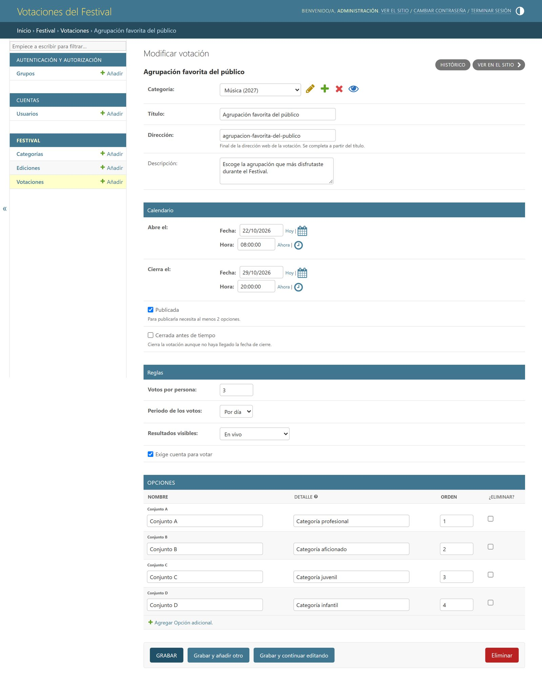

# Vallenata Festival Voting System

[](https://github.com/jsanchez542-hub/vallenata-festival-voting-system/actions/workflows/ci.yml)

Configurable public voting platform for the 60th Festival de la Leyenda Vallenata (Valledupar, Colombia, April 28 to May 1, 2027). It is a university team project for the Web Development course at Fundación Universitaria del Área Andina, built in phases that follow the course deliverables.

| Phase | What it delivers | Where |
| --- | --- | --- |
| 1. Analysis, design and prototype | Interactive front-end prototype that validates the flows and the interface, with data kept in the browser | Repository root, [live demo](https://jsanchez542-hub.github.io/vallenata-festival-voting-system/) |
| 2. Django and MySQL | Data model, Django admin, user accounts and public pages that read from MySQL | [`backend/`](backend/README.md) |
| Next | Casting votes under each poll's rules, duplicate control, results and audit log, then deployment | Not started |

This is an academic project. It is not an official site of the Fundación Festival de la Leyenda Vallenata, and all categories, polls and rules shown are sample data pending validation with the client.


## Phase 1: interactive prototype

The team wrote the analysis and design document together, and the prototype is its interactive counterpart. The brief for this phase was to analyze and design the platform before building it, so the prototype checks the flows and the interface, not the backend.

### What it covers

The voter journey, on mobile first:

1. Browse the current edition, its categories and the polls (open, upcoming, closed).
2. Create an account, accepting the personal data policy, or sign in.
3. Read the rules of a poll, choose an option, confirm the vote and receive a receipt code.
4. See results when the poll allows it.

The administration area:

- Editions and categories.
- Polls: dates, publication and rules.
- Options: add, edit, reorder and remove, with an optional image that is validated and resized in the browser.
- Results: totals, vote log, vote voiding and CSV export.

### A configurable platform

The client has not defined most voting rules yet, so nothing is hard coded to a single vote. Every poll carries its own rule:

| Parameter | Options in the prototype |
| --- | --- |
| Votes per voter | 1 to 10 |
| Period | In total, or per day |
| Results visibility | Organization only, after close, or live |
| Registration | Required or not |

Two of the sample polls use different rules on purpose, so the difference is visible in the interface. Security rules from the analysis are applied too: passwords are stored as salted SHA-256 hashes, sign-in locks for two minutes after five failed attempts, administration pages require an administrator session, a confirmed vote cannot be changed and every administrative action is written to an audit log. Publishing a poll requires at least two options and a closing date after the opening date, and an option that already has votes cannot be renamed or removed.

### Design

The palette and typefaces come from the Festival's own website: black and white, the Festival red (#DD3333) as the only accent, Raleway for headings and Poppins for text, both self-hosted. The layout borrows its structure from Colombia's tourism pages: a transparent menu over a full-width photo, a grey breadcrumb band and wide white content. The home page sets the edition number large in red next to the Festival's name, as the official poster does.

The administration area has its own console layout with a black sidebar, so it does not read as part of the public site.

The logo is four bars of different heights, one for each vallenato rhythm (paseo, merengue, son and puya), which also read as a results chart. No official logos are used.


### Quality checks

- Accessibility audit with axe-core (WCAG 2.1 AA): no violations on mobile or desktop.
- Contrast of the text over the photos checked from 360 to 1920 px wide.
- No horizontal scroll from 320 px, and no layout shift while pages load.
- Valid HTML (html-validate) and no ESLint errors (`npm run lint`).
- Keyboard navigation, visible focus and reduced motion support.
- No runtime dependencies and no build step.

### Screens

| Screen | File |
| --- | --- |
| Home | `index.html` |
| Sign up | `sign-up.html` |
| Sign in | `sign-in.html` |
| Categories | `categories.html` |
| Polls | `polls.html` |
| Poll detail | `poll.html` |
| Options | `options.html` |
| Vote confirmation | `confirm.html` |
| Result and receipt | `result.html` |
| Admin dashboard | `admin/dashboard.html` |
| Editions and categories | `admin/categories.html` |
| Polls management | `admin/polls.html` |
| Options management | `admin/options.html` |
| Results | `admin/results.html` |

### Run it locally

No install is needed to view the prototype. Serve the folder with any static server:

```
npm start
```

or

```
python -m http.server 8080
```

Then open http://localhost:8080.

### Demo accounts

| Role | Email | Password |
| --- | --- | --- |
| Voter | votante@ejemplo.co | Votante2027 |
| Administrator | admin@ejemplo.co | Admin2027 |

The sign-in page has one-click buttons for both accounts, and every page links to it from the footer. You can also create your own voter account, and the footer has a button to restore the sample data.

## Phase 2: Django and MySQL

The second deliverable asked for a Django project connected to MySQL: related models for the Edition, Category, Poll and Option chain, administration through the Django admin, sign-up, sign-in and sign-out with Django's authentication, and public pages that show real data. Casting votes belongs to the next phase, so open polls show their options and rules with a notice that voting is not enabled yet.

The pages reuse the prototype's CSS, fonts and images straight from `assets/`, so both phases look the same. Setup instructions are in [backend/README.md](backend/README.md).



### What it adds

- Four related models with constraints in the database: an edition cannot end before it starts, a poll cannot close before it opens, and names are unique within each edition and each poll.
- The prototype's per-poll rules as model fields: votes per voter, period, results visibility and whether an account is required.
- An admin with the categories inside each edition and the options inside each poll, a filter by poll status, and a check that blocks publishing a poll with fewer than two options.
- Accounts that sign in with email, record when the person accepted the personal data policy, use Django's password validators and lock sign-in for two minutes after five failed attempts with the same email from the same address.
- Public pages for the home, the editions, the categories of an edition, the polls of a category, all polls filtered by status, and each poll with its options and rules.
- A `load_demo_data` command that loads the prototype's sample edition, categories, polls and options, with poll dates relative to the day it runs.

### Technical decisions

- A custom user model from the first migration, with email as the login field. Django recommends starting a project with one because replacing the user model later is hard. Emails are stored in lowercase, so signing in ignores case.
- The current edition is not a flag. It is the next edition to finish, or the latest one when all have ended. MySQL has no conditional unique constraints, so a flag would need extra code to keep a single edition marked as current.
- Poll status (draft, upcoming, open or closed) is computed from the dates and the publish and close fields instead of being stored, so it cannot go stale. Querysets filter by status in SQL, and lists show open polls first.
- Editions with categories and categories with polls cannot be deleted, because the votes of the next phase will depend on them.
- `STATICFILES_DIRS` serves the prototype's `css`, `fonts` and `img` folders, so there is a single copy of the design. The prototype's JavaScript is not used: Django renders every page, and the backend adds one small script for the mobile menu and the messages.
- The sign-in lock uses Django's cache. The default in-memory cache works for a single process; a deployment with several processes needs Redis or Memcached.

### Quality checks

- Tests for models, constraints, status filters, template filters, the admin, public pages, accounts and the demo data command. GitHub Actions runs them against MySQL 8.4 on every push, together with ruff and ESLint.
- Accessibility audit with axe-core (WCAG 2.1 AA): no violations at 390 and 1440 px on any page, including form errors and the open mobile menu.
- Valid HTML (html-validate) on every page and form state.
- The home page runs three queries however many polls and categories it shows.

## Project structure

```
assets/
  css/          Design tokens, base, layout, components, page styles and admin console
  fonts/        Self-hosted fonts and their licenses
  img/          Photos, favicons, social preview card and the logo in every color version
  js/           Prototype data layer, UI modules and one module per page
admin/          Prototype administration pages
backend/
  accounts/     Custom user model, sign-up, sign-in and sign-out
  config/       Settings and URLs
  festival/     Editions, categories, polls and options: models, admin, views and the demo data command
  static/js/    Mobile menu, messages and page transitions
  templates/    Base layout, public pages, account forms and the admin override
docs/           Screenshots
```

## Limitations

- In the prototype, state lives in the browser (`localStorage`), so data is per device and sample data resets after 14 days. Its password hashing and sign-in lock run in the browser because there is no server; the Django backend uses Django's password hashers and a server-side lock.
- The backend does not record votes, results or an audit log yet, and it has no production deployment.
- Rules, categories and polls are examples. The open questions for the client are tracked in the project analysis document.

## Team and credits

Team project, Web Development course (group 202660-6A-62), Fundación Universitaria del Área Andina, 2026. The analysis and design document is the shared work of the team.

Prototype design and development, as the team's UX/UI and prototype lead: Miguel Sanchez Torres. The Django implementation in `backend/` is also his work; the team's joint submission for the second deliverable is kept in a separate team repository.

Fonts: Raleway and Poppins, both under the SIL Open Font License, with their license texts in `assets/fonts`. The logo lettering comes from Alfa Slab One and Archivo, also under the SIL Open Font License.
