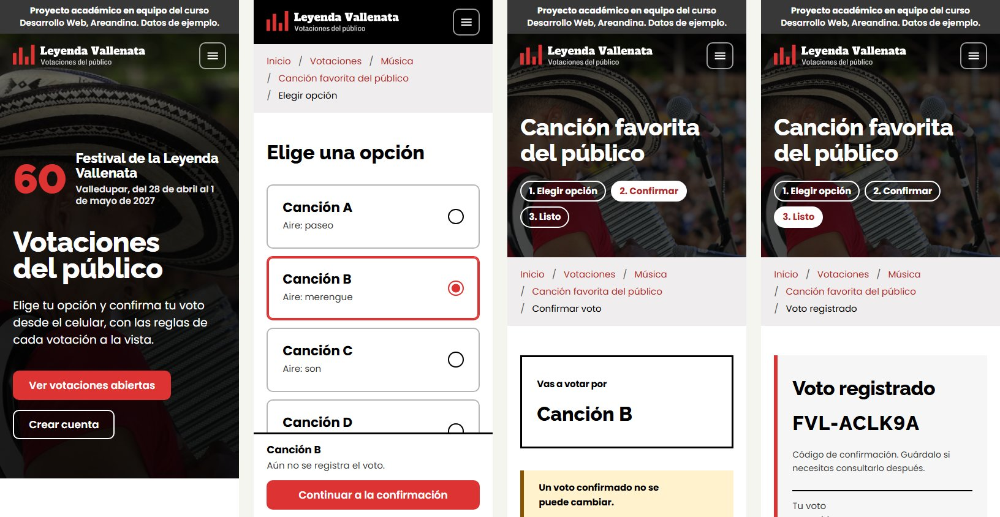
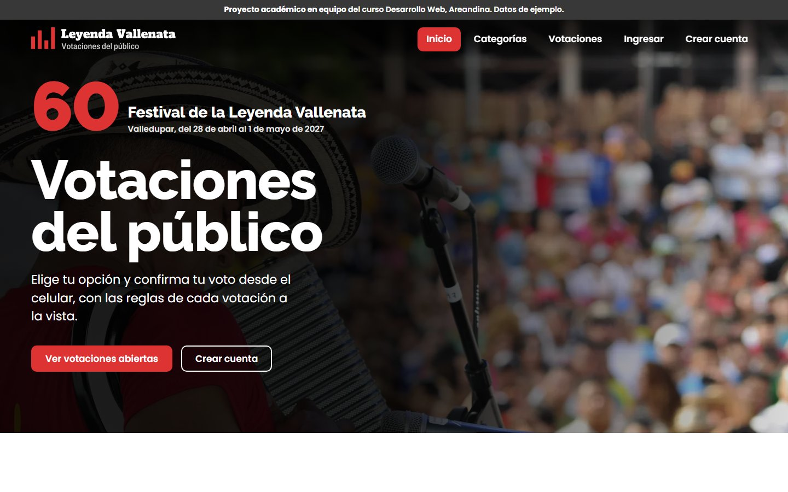
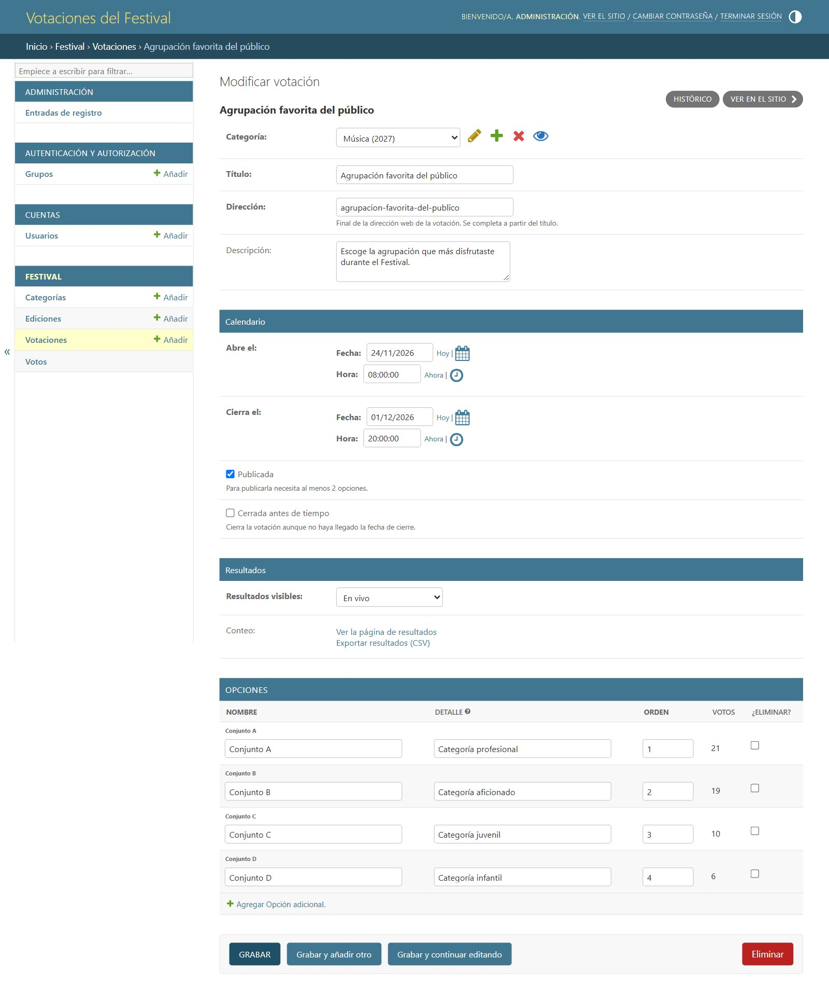
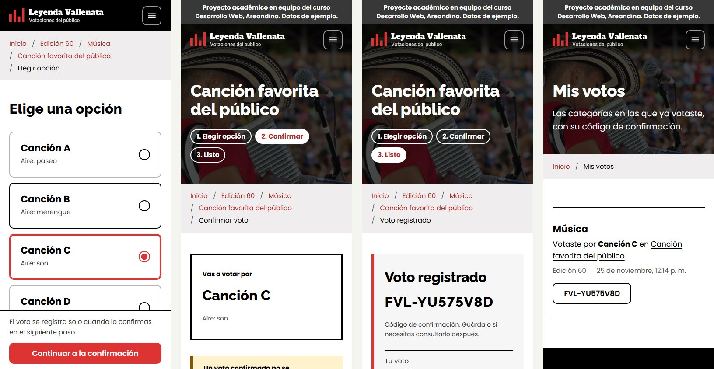
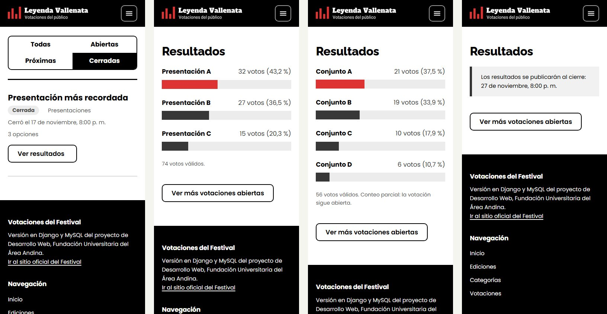

# Vallenata Festival Voting System

[](https://github.com/jsanchez542-hub/vallenata-festival-voting-system/actions/workflows/ci.yml)

Public voting platform for the 60th Festival de la Leyenda Vallenata (Valledupar, Colombia, April 28 to May 1, 2027). It is a university team project for the Web Development course at Fundación Universitaria del Área Andina, built in phases that follow the course deliverables.

I designed and coded the prototype, which runs as a [live demo](https://jsanchez542-hub.github.io/vallenata-festival-voting-system/) in plain HTML, CSS and JavaScript, and I built my own backend for deliverables 2 to 4 in `backend/`, with Django 5.2 and MySQL. The analysis and design document is the team's shared work, and the application the team presented for deliverables 2 to 4 is in a separate team repository.

| Phase | What it delivers | Where |
| --- | --- | --- |
| 1. Analysis, design and prototype | Interactive prototype that validates the flows and the interface, with its data kept in the browser | Repository root, [live demo](https://jsanchez542-hub.github.io/vallenata-festival-voting-system/) |
| 2. Django and MySQL | Data model, Django admin, user accounts and public pages that read from MySQL | [`backend/`](backend/README.md) |
| 3. Votes and API | One vote per voter, category and edition, with a confirmation step and a receipt, each voter's votes, a vote list in the admin that cannot be edited and a JSON API | [`backend/`](backend/README.md) |
| 4. Results | Results under each poll's visibility setting, vote counts and a CSV export in the admin, and a change log of the admin | [`backend/`](backend/README.md) |

This is an academic project. It is not an official site of the Fundación Festival de la Leyenda Vallenata, and all categories, polls and rules shown are sample data pending validation with the client.



## Phase 1: interactive prototype

The team wrote the analysis and design document together, and the prototype is its interactive counterpart. The brief for this phase was to analyze and design the platform before building it, so the prototype checks the flows and the interface, not the backend.

### What it covers

The voter journey, on mobile first:

1. Browse the current edition, its categories and the polls (open, upcoming, closed).
2. Create an account, accepting the personal data policy, or sign in.
3. Read the rules of a poll, choose an option, confirm the vote and receive a receipt code.
4. See results when the poll allows it.

The administration area:

- Editions and categories.
- Polls: dates, publication and rules.
- Options: add, edit, reorder and remove, with an optional image that is validated and resized in the browser.
- Results: totals, vote log, vote voiding and CSV export.

### A configurable platform

The client has not defined most voting rules yet, so nothing is hard coded to a single vote. Every poll carries its own rule:

| Parameter | Options in the prototype |
| --- | --- |
| Votes per voter | 1 to 10 |
| Period | In total, or per day |
| Results visibility | Organization only, after close, or live |
| Registration | Required or not |

Two of the sample polls use different rules on purpose, so the difference is visible in the interface. Security rules from the analysis are applied too: the prototype stores passwords in the browser as salted SHA-256 hashes (the Django backend uses Django's password hashers), sign-in locks for two minutes after five failed attempts, administration pages require an administrator session, a confirmed vote cannot be changed and every administrative action is written to an audit log. Publishing a poll requires at least two options and a closing date after the opening date, and an option that already has votes cannot be renamed or removed.

### Design

The palette and typefaces come from the Festival's own website: black and white, the Festival red (#DD3333) as the only accent, Raleway for headings and Poppins for text, both served from `assets/fonts` instead of a font service. The layout borrows its structure from Colombia's tourism pages: a transparent menu over an image that spans the whole width, a grey breadcrumb band and wide white content. The home page sets the edition number large in red next to the Festival's name, as the official poster does.

The administration area has its own console layout with a black sidebar, so it does not read as part of the public site.

The logo is four bars of different heights, one for each vallenato rhythm (paseo, merengue, son and puya), which also read as a results chart. No official logos are used.



### Quality checks

- No axe-core violations (WCAG 2.1 AA) on any page or on the 404 page at 390 and 1440 px, checked by hand with axe-core 4.14 on 25 November 2026.
- Contrast of the text over the photos checked from 360 to 1920 px wide.
- No horizontal scroll from 320 px, and no layout shift while pages load.
- Valid HTML and no ESLint errors: CI runs `npm run check:html` (html-validate) and `npm run lint` on every push.
- Keyboard navigation, visible focus and reduced motion support.
- No runtime dependencies and no build step.

### Screens

| Screen | File |
| --- | --- |
| Home | `index.html` |
| Sign up | `sign-up.html` |
| Sign in | `sign-in.html` |
| Categories | `categories.html` |
| Polls | `polls.html` |
| Poll detail | `poll.html` |
| Options | `options.html` |
| Vote confirmation | `confirm.html` |
| Result and receipt | `result.html` |
| Admin dashboard | `admin/dashboard.html` |
| Editions and categories | `admin/categories.html` |
| Polls management | `admin/polls.html` |
| Options management | `admin/options.html` |
| Results | `admin/results.html` |

### Run it locally

No install is needed to view the prototype. Serve the folder with any static server:

```
npm start
```

or

```
python -m http.server 8080
```

Then open http://localhost:8080.

### Demo accounts

| Role | Email | Password |
| --- | --- | --- |
| Voter | votante@ejemplo.co | Votante2027 |
| Administrator | admin@ejemplo.co | Admin2027 |

The sign-in page has a button for each account that signs in with one click, and every page links to it from the footer. You can also create your own voter account, and the footer has a button to restore the sample data.

## Phase 2: Django and MySQL

The second deliverable asked for a Django project connected to MySQL: related models for the Edition, Category, Poll and Option chain, administration through the Django admin, sign-up, sign-in and sign-out with Django's authentication, and public pages that show real data. Casting votes was left for the next phase, so at this point open polls showed their options and rules with a notice that voting was not enabled yet.

The pages reuse the prototype's CSS, fonts and images straight from `assets/`, so both phases look the same. Setup instructions are in [backend/README.md](backend/README.md).



### What it adds

- Four related models with constraints in the database: an edition cannot end before it starts, a poll cannot close before it opens, and names are unique within each edition and each poll.
- The rules each poll had in the prototype, as model fields: votes per voter, period, results visibility and whether an account is required. Phase 3 replaced all of them except results visibility with the course's voting rule.
- An admin with the categories inside each edition and the options inside each poll, a filter by poll status, and a check that blocks publishing a poll with fewer than two options.
- Accounts that sign in with email, record when the person accepted the personal data policy and use Django's password validators. Every two minutes, each address gets five failed sign-ins per account and twenty in total.
- Public pages for the home, the editions, the categories of an edition, the polls of a category, all polls filtered by status, and each poll with its options and rules.
- A `load_demo_data` command that loads the prototype's sample edition, categories, polls and options, with poll dates relative to the day it runs.

### Technical decisions

- A custom user model from the first migration, with email as the login field. Django recommends starting a project with one because replacing the user model later is hard. Emails are stored in lowercase, so signing in ignores case.
- The current edition is not a flag. It is the next edition to finish, or the latest one when all have ended. MySQL has no conditional unique constraints, so a flag would need extra code to keep a single edition marked as current.
- Poll status (draft, upcoming, open or closed) is computed from the dates and the publish and close fields instead of being stored, so it cannot go stale. Querysets filter by status in SQL, and lists show open polls first.
- Editions with categories and categories with polls cannot be deleted, because the votes of the next phase will depend on them.
- `STATICFILES_DIRS` serves the prototype's `css`, `fonts` and `img` folders, so there is a single copy of the design. The prototype's JavaScript is not used: Django renders every page, and the backend adds one small script for the mobile menu and the messages.
- The sign-in limit counts every attempt with an atomic cache increment before the password is checked, so parallel requests cannot get past it. The address is part of every count on purpose: a count for the account alone would let anyone lock a voter out by entering a wrong password five times. The cost is that someone who changes address gets five more tries. Within an address, the count belongs to the account the email resolves to, because MySQL compares emails without case or accents and each spelling would otherwise get its own count. Django's default cache keeps the counts in the memory of one process; a deployment with several processes needs Redis or Memcached, and behind a proxy `REMOTE_ADDR` has to carry the client's address.

### Quality checks

- Tests for models, constraints, status filters, template filters, the admin, public pages, accounts and the demo data command. GitHub Actions runs them against MySQL 8.4 on every push, together with ruff and ESLint.
- No axe-core violations (WCAG 2.1 AA) at 390 and 1440 px on any page, including form errors and the open mobile menu, checked by hand on 23 October 2026.
- Valid HTML (html-validate) on every page and form state, checked by hand on the same day.
- The home page runs three queries however many polls and categories it shows.

## Phase 3: votes, validation and API

The third deliverable asked for a real voting module on top of the second phase: sign in, choose an option, confirm it and store the vote in MySQL. The course set the central rule for every team: one vote per user, category and edition, even when a category has several polls, while voting in other categories stays possible. It also asked for checks on the server against closed polls, options from other polls and unauthorized requests, protection against simultaneous duplicates, a page with each voter's categories, an admin view of the votes and a GET endpoint that returns the categories and their options as JSON.



### What it adds

- The prototype's three steps (choose an option, confirm, done) as Django pages, with a receipt code in the same `FVL-` format.
- A `Vote` model that links the voter, the edition, the category and the option, with a unique constraint on voter, edition and category.
- Checks on every request before a vote is saved: the voter is signed in, the poll is open, the option belongs to the poll and the voter has no vote in that category yet. A request built by hand gets the same refusal as the form.
- A My votes page with the categories the person voted in and their receipts, and a receipt page that only its voter can open.
- A vote list in the Django admin that can be searched and filtered but not added to, changed or deleted.
- `GET /api/categories/`, the assignment's `/api/categorias/` with an English path like the rest of the site. It returns the active categories with their published polls and options as JSON.
- Sample data with two open polls in Música, so the category rule can be tried, and an open poll in another category.

### Technical decisions

- The course's rule replaces the limits each poll had in the prototype: votes per voter, daily periods and polls without an account. Keeping those fields would leave admin settings that do nothing, so the migration removes them. Results visibility stays for the next phase.
- The rule is enforced twice. The form gives a clear message in normal use, and the unique constraint in MySQL settles requests that pass the form check at the same moment. The view saves inside a transaction, catches the integrity error and answers with the same message instead of a server error.
- A vote stores its edition and category next to the option because MySQL can only enforce a unique constraint on columns of one table. Both are copied from the option when the vote is cast, and the admin rejects the two edits that would make them disagree: moving a poll with votes to another category and moving a category with votes to another edition.
- The receipt column is unique too, so an integrity error can also mean a repeated code. Casting a vote checks whether the ballot already exists before calling it a duplicate, and otherwise tries again with a new code.
- Votes protect what they point to. Voters, options, categories and editions with votes cannot be deleted, and the poll form does not let an option with votes be renamed or removed.
- Choosing an option is a GET request to the confirmation page, which saves nothing. Only the confirmation is a POST, protected by Django's CSRF token.
- The API runs three queries however many categories it returns, gives dates in Colombia time and answers 405 to any method other than GET.

### Quality checks

- 94 tests. The new ones follow the course's test cases CP-01 to CP-10, including eight threads that post the same vote at once against MySQL and leave a single vote. GitHub Actions runs them on MySQL 8.4.
- axe-core (WCAG 2.1 AA) reports no violations on the new pages at 390 and 1440 px, and their HTML passes html-validate, both checked by hand on 4 November 2026.

## Phase 4: results

The final deliverable was a live demonstration of the whole application: the admin, accounts, voting, the duplicate check, results read from the database, MySQL and the validations. The backend covered everything except the results, so this phase adds them under the visibility setting each poll has kept since the second phase.



### What it adds

- A results page for every published poll at `/polls/<slug>/results/`, with the prototype's bars, the votes and share of each option and the leading option highlighted.
- The prototype's three visibility settings, applied on the server: results from the moment a poll opens, results after it closes, or results for the organization only. Staff members always see the count, with a notice while the public cannot see it.
- Links to the results from closed polls in the lists and on the poll page, and from the poll page and the receipt when the setting already allows it.
- Vote counts in the admin: a column in the poll list and the votes of each option in the poll form, which also links to the results page and to a CSV export in the prototype's format.
- A change log in the admin that cannot be edited, with who created, changed or deleted each edition, category, poll and option. It lists the history that the Django admin already records.
- Sample votes in the demo data, a tenth of the prototype's, cast by accounts that cannot sign in, so the closed poll and the live poll show results from the start.

### Technical decisions

- Visibility is decided in the model (`Poll.results_visible_to`), so the page, the links and the tests share one rule. When the public cannot see the count, the view does not run the count query.
- The count is a single `GROUP BY` query whatever the number of options. Options keep their own order, as in the prototype, and a tie highlights every leading option.
- The admin list counts options and votes in the same query, so both counts use `distinct`; without it, the join multiplies the option count by the votes.
- A confirmed vote is final, so the backend has no vote voiding and nobody can edit the vote list in the admin.
- The CSV starts with a byte order mark so that Excel reads it as UTF-8, and only staff members can download it. An option name that starts with `=`, `+`, `-` or `@` gets a leading quote, so a spreadsheet shows it as text instead of running it as a formula.

### Quality checks

- 124 tests at the end of the phase, 30 of them new: each visibility setting for the public, voters and staff, the count with ties and without votes, every state of the results page, the links, the admin counts, the CSV, its protection against formulas and the change log.
- The new pages load without horizontal scrolling or console errors at 390 and 1440 px.

## Project structure

```
assets/
  css/          Design tokens, base, layout, components, page styles and admin console
  fonts/        Font files and their licenses
  img/          Photos, favicons, social preview card and the logo in every color version
  js/           Prototype data layer, UI modules and one module per page
admin/          Prototype administration pages
backend/
  accounts/     Custom user model, sign-up, sign-in and sign-out
  config/       Settings and URLs
  festival/     Editions, categories, polls, options, votes and results: models, admin, views, the JSON API, the CSV export and the demo data command
  static/js/    Mobile menu, messages and page transitions
  templates/    Base layout, public pages, account forms and the admin override
docs/           Screenshots
```

## Limitations

- In the prototype, state lives in the browser (`localStorage`), so data is per device and sample data resets after 14 days. Its password hashing and sign-in lock run in the browser because there is no server; the Django backend uses Django's password hashers and limits failed sign-ins on the server.
- The Django backend has no production deployment, because the course only required running it locally. The results pages and the JSON API answer where the project runs; the prototype is the part published on GitHub Pages.
- Rules, categories and polls are examples. The open questions for the client are tracked in the project analysis document.

## Team and credits

Team project, Web Development course (group 202660-6A-62), Fundación Universitaria del Área Andina, 2026. In the team I led the UX/UI design and the prototype, and the analysis and design document is the work of the whole team.

Fonts: Raleway and Poppins, both under the SIL Open Font License, with their license texts in `assets/fonts`. The logo lettering comes from Alfa Slab One and Archivo, also under the SIL Open Font License.
