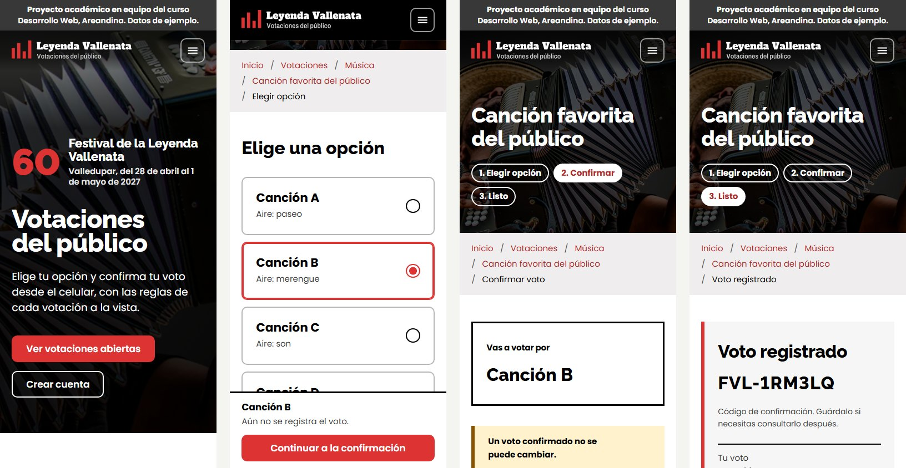
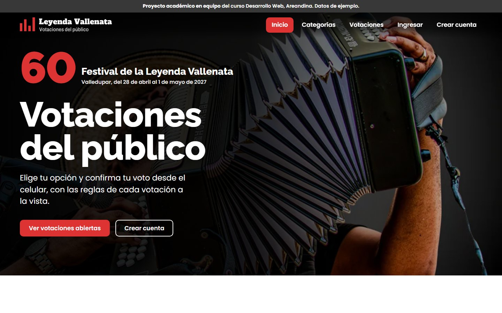

# Vallenata Festival Voting System

Interactive front-end prototype of a configurable public voting platform for the 60th Festival de la Leyenda Vallenata (Valledupar, Colombia, April 28 to May 1, 2027).

**Live demo:** https://jsanchez542-hub.github.io/vallenata-festival-voting-system/

It is part of a university team project for the Web Development course at Fundación Universitaria del Área Andina (first deliverable: analysis, design and prototype). The team wrote the analysis and design document together, and this prototype is its interactive counterpart. The brief was to analyze and design the platform before building it, so this prototype validates the flows and the interface, not the backend. The target stack for the real system is Django and MySQL.

This is an academic prototype. It is not an official site of the Fundación Festival de la Leyenda Vallenata, and all categories, polls and rules shown are sample data pending validation with the client.



## What it covers

The voter journey, on mobile first:

1. Browse the current edition, its categories and the polls (open, upcoming, closed).
2. Create an account, accepting the personal data policy, or sign in.
3. Read the rules of a poll, choose an option, confirm the vote and receive a receipt code.
4. See results when the poll allows it.

The administration area:

- Editions and categories.
- Polls: dates, publication and rules.
- Options: add, edit, reorder and remove, with an optional image that is validated and resized in the browser.
- Results: totals, vote log, vote voiding and CSV export.

## The core idea: a configurable platform

The client has not defined most voting rules yet, so nothing is hard coded to a single vote. Every poll carries its own rule:

| Parameter | Options in the prototype |
| --- | --- |
| Votes per voter | 1 to 10 |
| Period | In total, or per day |
| Results visibility | Organization only, after close, or live |
| Registration | Required or not |

Two of the sample polls use different rules on purpose, so the difference is visible in the interface. Security rules from the analysis are applied too: passwords are stored as salted SHA-256 hashes, sign-in locks for two minutes after five failed attempts, administration pages require an administrator session, a confirmed vote cannot be changed and every administrative action is written to an audit log. Publishing a poll requires at least two options and a closing date after the opening date, and an option that already has votes cannot be renamed or removed.

## Design

The palette and typefaces come from the Festival's own website: black and white, the Festival red (#DD3333) as the only accent, Raleway for headings and Poppins for text, both self-hosted. The layout borrows its structure from Colombia's tourism pages: a transparent menu over a full-width photo, a grey breadcrumb band and wide white content. The home page sets the edition number large in red next to the Festival's name, as the official poster does.

The administration area has its own console layout with a black sidebar, so it does not read as part of the public site.

The logo is four bars of different heights, one for each vallenato rhythm (paseo, merengue, son and puya), which also read as a results chart. No official logos are used.



## Quality checks

- Accessibility audit with axe-core (WCAG 2.1 AA): no violations on mobile or desktop.
- Contrast of the text over the photos checked from 360 to 1920 px wide.
- No horizontal scroll from 320 px, and no layout shift while pages load.
- Valid HTML (html-validate) and no ESLint errors (`npm run lint`).
- Keyboard navigation, visible focus and reduced motion support.
- No runtime dependencies and no build step.

## Screens

| Screen | File |
| --- | --- |
| Home | `index.html` |
| Sign up | `sign-up.html` |
| Sign in | `sign-in.html` |
| Categories | `categories.html` |
| Polls | `polls.html` |
| Poll detail | `poll.html` |
| Options | `options.html` |
| Vote confirmation | `confirm.html` |
| Result and receipt | `result.html` |
| Admin dashboard | `admin/dashboard.html` |
| Editions and categories | `admin/categories.html` |
| Polls management | `admin/polls.html` |
| Options management | `admin/options.html` |
| Results | `admin/results.html` |

## Run it locally

No install is needed to view the prototype. Serve the folder with any static server:

```
npm start
```

or

```
python -m http.server 8080
```

Then open http://localhost:8080.

## Demo accounts

| Role | Email | Password |
| --- | --- | --- |
| Voter | votante@ejemplo.co | Votante2027 |
| Administrator | admin@ejemplo.co | Admin2027 |

The sign-in page has one-click buttons for both accounts, and every page links to it from the footer. You can also create your own voter account, and the footer has a button to restore the sample data.

## Project structure

```
assets/
  css/        Design tokens, base, layout, components, page styles and admin console
  fonts/      Self-hosted fonts and their licenses
  img/        Photos, favicons and social preview card
    brand/    Logo and symbol in every color version
  js/
    data/     Seed, storage, authentication, poll rules and admin operations
    ui/       DOM helpers, layout chrome, forms, tables and views
    pages/    One module per page
admin/        Administration console pages
docs/         Screenshots
```

## Limitations

- State lives in the browser (`localStorage`), so data is per device and sample data resets after 14 days.
- Password hashing and the sign-in lock run in the browser because there is no server. The Django implementation will rely on its own password hashers and server-side rate limiting.
- Rules, categories and polls are examples. The open questions for the client are tracked in the project analysis document.

## Team and credits

Team project, Web Development course (group 202660-6A-62), Fundación Universitaria del Área Andina, 2026. The analysis and design document is the shared work of the team.

Prototype design and development, as the team's UX/UI and prototype lead: Miguel Sanchez Torres.

Fonts: Raleway and Poppins, both under the SIL Open Font License, with their license texts in `assets/fonts`. The logo lettering comes from Alfa Slab One and Archivo, also under the SIL Open Font License.
