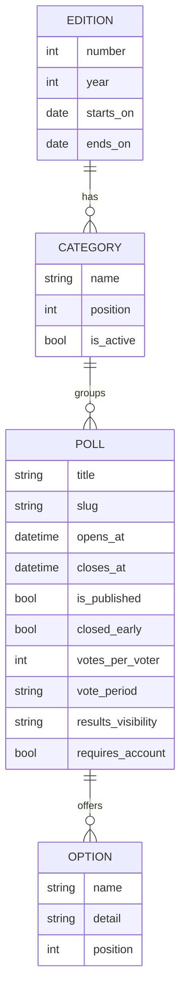

# Backend

Django 5.2 LTS and MySQL implementation of the second deliverable. The templates use the prototype's CSS, fonts and images from `../assets`, and every date is shown in Colombia time (America/Bogota).

## Requirements

- Python 3.12 or newer.
- MySQL 8.0 or newer, or MariaDB 10.5 or newer. It was developed on MariaDB 10.11 and CI runs on MySQL 8.4.
- On Linux and macOS, the client headers that `mysqlclient` compiles against (`pkg-config` and `libmysqlclient-dev` on Debian and Ubuntu). On Windows, pip installs a prebuilt wheel.

## Setup

1. Create the database and a user for it:

   ```sql
   CREATE DATABASE festival_voting CHARACTER SET utf8mb4 COLLATE utf8mb4_unicode_ci;
   CREATE USER 'festival_app'@'localhost' IDENTIFIED BY 'choose-a-password';
   GRANT ALL PRIVILEGES ON festival_voting.* TO 'festival_app'@'localhost';
   GRANT ALL PRIVILEGES ON test_festival_voting.* TO 'festival_app'@'localhost';
   ```

   The second grant lets Django create and drop the test database.

2. Create a virtual environment and install the dependencies:

   ```
   cd backend
   python -m venv .venv
   .venv\Scripts\activate          # Windows
   source .venv/bin/activate       # Linux and macOS
   pip install -r requirements.txt
   ```

3. Copy `.env.example` to `.env` and set `DJANGO_SECRET_KEY` and `DB_PASSWORD`. This prints a new secret key:

   ```
   python -c "import secrets; print(secrets.token_urlsafe(50))"
   ```

4. Create the tables, load the sample data and create an administrator account:

   ```
   python manage.py migrate
   python manage.py load_demo_data
   python manage.py createsuperuser
   ```

5. Start the server with `python manage.py runserver` and open http://127.0.0.1:8000. The admin is at http://127.0.0.1:8000/admin/ and the site header links to it when you sign in with a staff account.

`load_demo_data` can run again at any time. It updates the same rows and moves the poll dates so that two polls stay open, one upcoming and one closed.

## Environment variables

| Variable | Purpose | Default |
| --- | --- | --- |
| `DJANGO_SECRET_KEY` | Signs sessions and tokens | Required |
| `DJANGO_DEBUG` | `true` for local development | `false` |
| `DJANGO_ALLOWED_HOSTS` | Comma-separated host names the site answers to | `127.0.0.1,localhost` |
| `DJANGO_CSRF_TRUSTED_ORIGINS` | Comma-separated origins allowed to post forms, needed behind a proxy | Empty |
| `DB_NAME`, `DB_USER`, `DB_PASSWORD` | Database credentials | Required |
| `DB_HOST`, `DB_PORT` | Database server | `127.0.0.1`, `3306` |

Settings read these variables from the environment first and then from `backend/.env`. With `DJANGO_DEBUG` off, session and CSRF cookies are only sent over HTTPS, so a local run over plain HTTP needs `DJANGO_DEBUG=true`.

## Tests and checks

```
python manage.py test
pip install ruff
ruff check .
ruff format --check .
```

The tests create `test_festival_voting`, run against it and drop it at the end. ESLint for the two scripts in `static/js` runs from the repository root with `npm run lint`.

## Pages

| URL | Page |
| --- | --- |
| `/` | Current edition, its open polls and its categories |
| `/editions/` | All editions |
| `/editions/<year>/` | Categories of an edition |
| `/categories/` | Redirects to the categories of the current edition |
| `/categories/<id>/` | Polls of a category |
| `/polls/` | Polls of the current edition, filtered with `?status=open`, `upcoming` or `closed` |
| `/polls/<slug>/` | Options and rules of a poll |
| `/accounts/sign-up/`, `/accounts/sign-in/` | Account forms |
| `/accounts/sign-out/` | Ends the session (POST only) |
| `/admin/` | Django admin |

Drafts, polls in inactive categories and inactive categories return 404.

## Data model



The user model (`accounts.User`) replaces Django's default one: it has no username, signs in with a unique email and stores `privacy_accepted_at`, the moment the person accepted the personal data policy when signing up.

## Layout

```
config/       Settings, URLs and the WSGI entry point
accounts/     User model and manager, forms, the sign-in limit, views and admin
festival/     Models, admin, public views, template filters and the load_demo_data command
templates/    Base layout, public pages, account forms, the 404 page and the admin override
static/js/    Mobile menu, message dismissal and page transition handling
```
